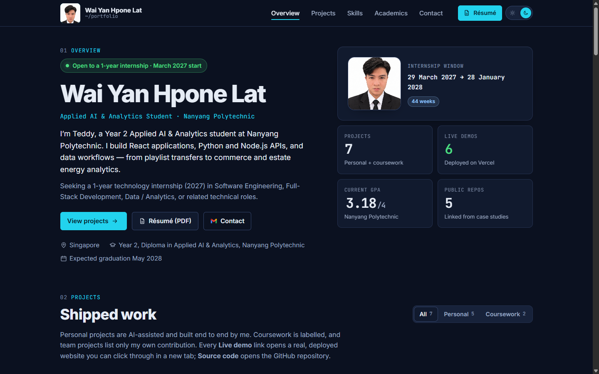

# Teddy Qyuon Portfolio

Personal portfolio for **Wai Yan Hpone Lat (Teddy)**, an Applied AI & Analytics student at Nanyang Polytechnic. It brings together verified project work, technical skills, academic results, résumé access and contact links.

**[View the live portfolio](https://teddy-qyuon-portfolio.vercel.app)** · [UI/UX completion report](docs/uiux-upgrade/README.md)



## Features

- Seven project case studies with screenshots, architecture, results and clearly attributed contributions.
- Project filters for personal work and coursework.
- Skills charts, semester results and a GPA trend chart.
- Responsive navigation, active section links and case-study reading progress.
- Persistent light/dark themes, keyboard focus states and reduced-motion support.
- A dashboard boot sequence, stable number counters and data reveals triggered on entering view.
- Lazy-loaded case studies with hover/focus preloading and delayed loading feedback.
- Downloadable résumé, direct contact links and a custom not-found page.

## Built with

| Technology | Version / purpose |
|---|---|
| React | 18.3.1 |
| React DOM | 18.3.1 |
| React Router | 7.18.4 |
| Vite | 7.3.7 |
| Styling | Plain CSS, shared design tokens and native browser motion features |
| Hosting | Vercel |

This is a frontend-only application. Site content is maintained in local data modules; no backend, database or environment variables are required to run it.

## Run locally

Requirements: **Node.js 20.19+ within 20.x, or Node.js 22.12+**, and npm.

```bash
git clone https://github.com/TeddyQyuon/TeddyQyuonPortfolio.git portfolio
cd portfolio
npm ci
npm run dev
```

Open **http://127.0.0.1:5173**.

On Windows PowerShell, use `npm.cmd` in place of `npm` if your execution policy blocks the PowerShell launcher.

## Commands

| Command | Purpose |
|---|---|
| `npm run dev` | Start the local development server on port 5173 |
| `npm test` | Run the Node test suite |
| `npm run build` | Create the production bundle in `dist/` |
| `npm run preview` | Serve the built site on port 4174 with production security headers |

To check the production build locally:

```bash
npm test
npm run build
npm run preview
```

Open **http://127.0.0.1:4174**. The development server and preview server use fixed ports.

## Project structure

```text
src/
  assets/       Project screenshots, portraits and technology icons
  components/   Shared UI, layout, charts and case-study components
  config/       Site metadata and navigation configuration
  data/         Project, skills, education, academic and personal content
  hooks/        Theme, navigation, metadata and motion behavior
  lib/          Project helpers and route preloading
  motion/       Shared JavaScript motion tokens
  pages/        Home, project case studies and not-found routes
  sections/     Homepage sections
  styles/       Design tokens, layouts, components and motion CSS
public/         Résumé, theme initialization, robots and social preview
tests/          Content, routing, security and motion guardrails
docs/           Baseline measurements, QA evidence and completion reports
```

## Content and deployment

Update portfolio content through `src/data/`. Site-wide metadata and navigation live in `src/config/site.js`. Motion durations are shared between `src/styles/tokens.css` and `src/motion/tokens.js`, with parity checked by tests.

The production build outputs to `dist/`. `vercel.json` configures the single-page route fallback and security headers, including the Content Security Policy. Local preview uses those same headers so CSP issues can be caught before deployment.

## SEO and social previews

`npm.cmd run build` runs Vite, then generates one static HTML entry for each of the seven project routes and one `dist/sitemap.xml`. Project data is the sitemap source; there is no second sitemap in `public/`. The existing `useDocumentMeta` hook and the generator share helpers in `src/utils/seo.js`, so client navigation and link-preview crawlers receive matching project titles, descriptions, canonical URLs and social tags.

Vercel project rewrites precede the SPA fallback. Local `npm.cmd run preview` applies the same project-file lookup under the production CSP; `curl.exe http://127.0.0.1:4174/projects/gamevault-marketplace` returns project metadata without running JavaScript. Generated pages retain Vite's hashed external assets and contain no inline scripts or styles. See [Task 7 verification](docs/post-uiux-seo/task-7.md) for results and the sitemap decision.

## Quality checks

The test suite checks content integrity, asset references, hash handling, pinned dependencies, security headers and motion constraints. The recorded UI/UX validation also covers responsive layouts, keyboard navigation, reduced motion, theme switching and live production smoke checks.

- [UI/UX specification](UIUX_UPGRADE.md)
- [Baseline measurements](docs/uiux-baseline/README.md)
- [Completion report, results and verification limits](docs/uiux-upgrade/README.md)
- [Production smoke-check results](docs/uiux-upgrade/release-checks.json)

## Author

**Wai Yan Hpone Lat (Teddy)** · [GitHub](https://github.com/TeddyQyuon) · [LinkedIn](https://www.linkedin.com/in/waiyanhponelat)
